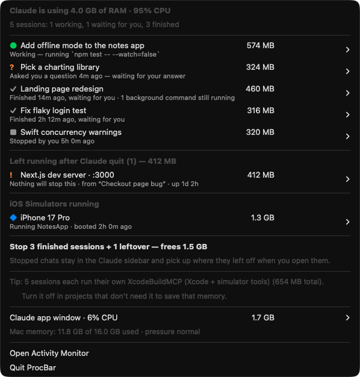
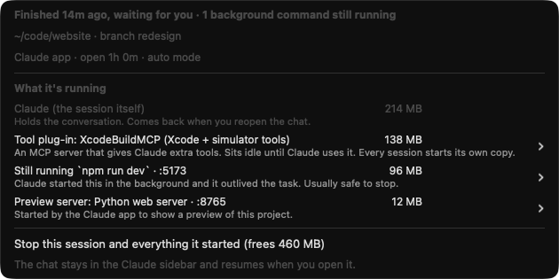

# ProcBar

A macOS menu bar app that shows what Claude Code is running on your Mac, what each session is doing right now, and what is safe to stop.

Claude Code sessions keep running after their task is done, and so does everything they started: MCP servers, dev servers, background commands, preview servers, iOS simulators. ProcBar puts all of it in one menu, in plain words, with a Stop button next to each item.



## What it shows

**Every session, with its status in plain words.** ProcBar reads the end of each session's chat history to work out what it's doing:

| | Status | Meaning |
|---|---|---|
| 🟢 | Working — running `npm test` | Claude is in the middle of a task. It shows the command it's running or the file it's editing. |
| 🟠 | Waiting for your answer | Claude asked you a question or is showing you a plan. |
| 🟠 | Probably waiting for your approval | A command is queued but nothing is running. |
| ✓ | Finished 14m ago, waiting for you | The task is done. The session only holds memory now. |
| ■ | Stopped by you | You interrupted it. |

**What each session started.** Open a session to see each process it owns, with a one-line explanation and its memory:



- **Tool plug-ins (MCP servers).** Every session starts its own copy of each one. ProcBar shows a tip when the same plug-in is duplicated across many sessions.
- **Commands.** It shows what's running for the current task, and flags background commands (like `npm run dev`) that kept running after the task finished.
- **Preview servers** that the Claude desktop app started for the project, matched to the session by folder.
- **Listening ports**, with a link to open `http://localhost:<port>`.

**Leftovers.** Processes from sessions that have already exited, like a dev server left running after you closed the chat. Nothing will ever stop these. ProcBar finds them through the Claude environment variables they inherited, and shows which chat started them.

**iOS Simulators** that are still booted after a build or test, with a Shut down button.

**One-click cleanup.** "Stop 3 finished sessions + 1 leftover — frees 1.5 GB". Chats you stop stay in the Claude sidebar and pick up where they left off when you open them. If a session is still working, ProcBar asks before stopping it.

The menu bar title shows your Mac's memory use and how many Claude sessions are open. It turns orange or red under memory pressure.

## Install

You need macOS 13 or later and the Xcode command line tools (`xcode-select --install`).

```bash
git clone https://github.com/waleedrizwan/procbar.git
cd procbar
./install.sh
```

This builds `ProcBar.app` into `~/Applications`, starts it, and adds a login item so it starts when you log in.

To uninstall:

```bash
./install.sh --uninstall
```

## How it works

- It's two Swift files with no dependencies, built with `swiftc` by the install script.
- When idle it does almost nothing: it reads memory stats every 5 seconds and samples CPU time every 15 seconds. The full process scan only runs when you open the menu.
- It finds sessions by the `claude` binary. It works for both the Claude desktop app and the terminal CLI.
- It reads session titles from the Claude desktop app's local session files, and each session's status from the end of its transcript in `~/.claude/projects`.
- Everything stays on your Mac. ProcBar makes no network requests.
- Stop sends `SIGTERM` to the whole process tree, then `SIGKILL` to anything still running 2 seconds later.

### Debugging

```bash
# Print the menu as text
~/Applications/ProcBar.app/Contents/MacOS/ProcBar --dump

# Regenerate the README screenshots from made-up sessions
~/Applications/ProcBar.app/Contents/MacOS/ProcBar --demo docs
```

ProcBar isn't affiliated with Anthropic.
